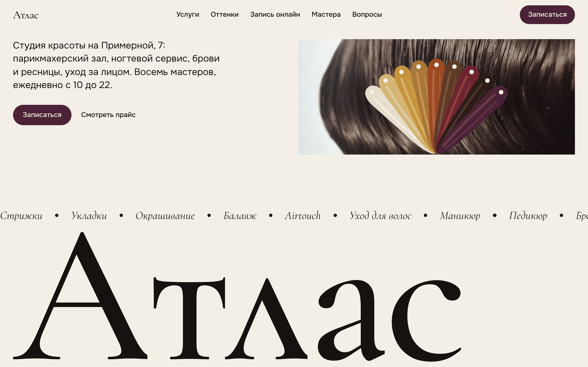
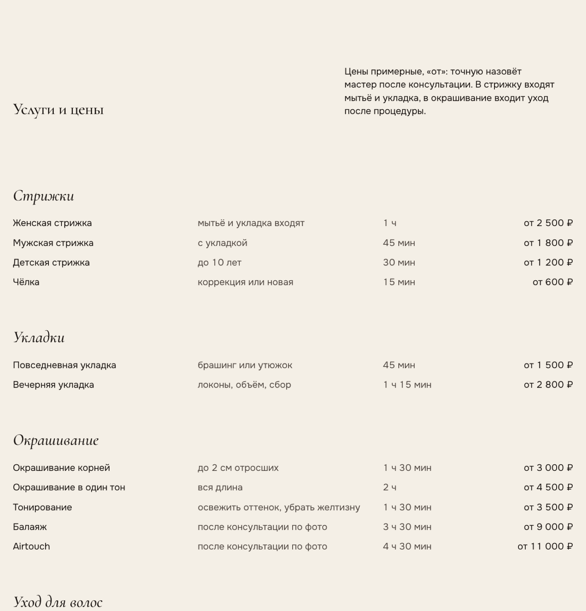
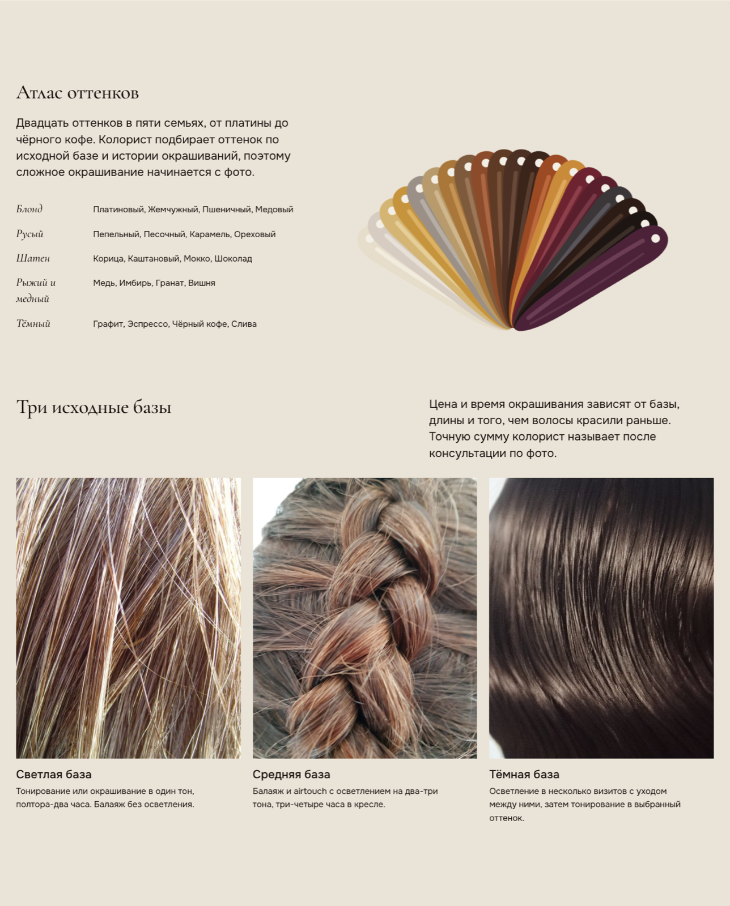
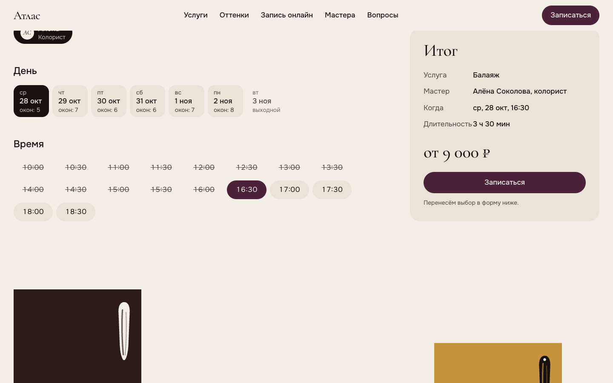
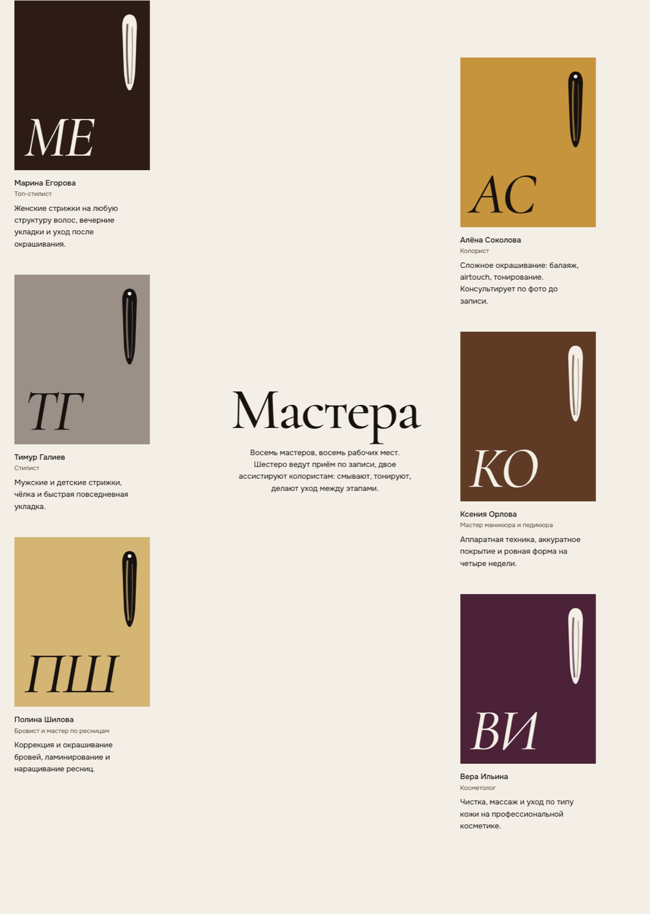
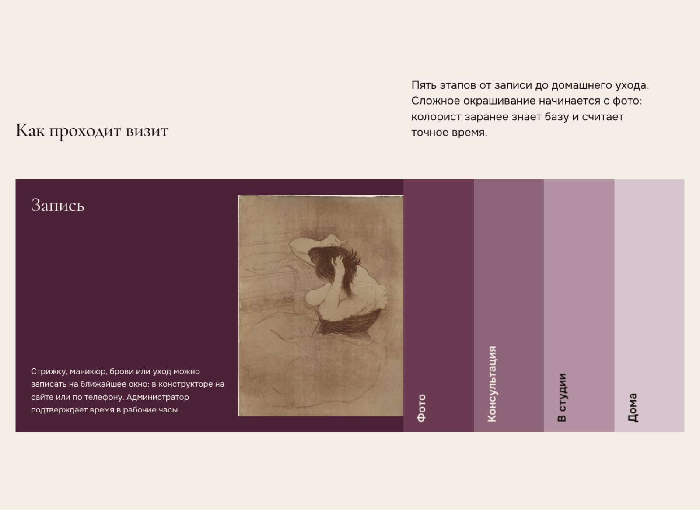
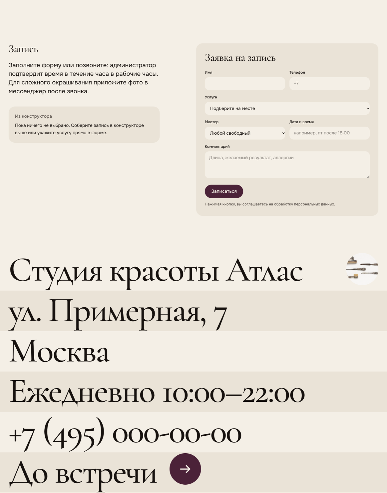
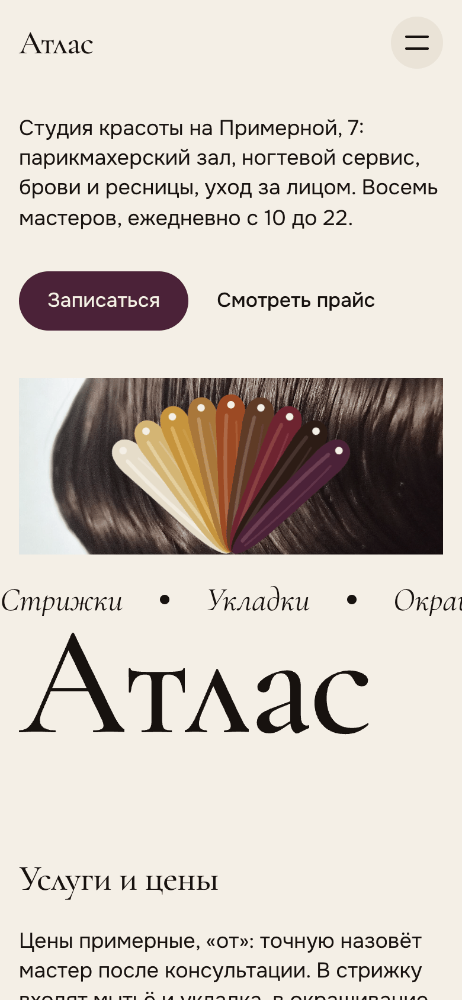

# Атлас — сайт студии красоты

Одностраничный сайт студии красоты с полным прайсом, конструктором записи и формой заявки. Демо для портфолио: компания вымышленная, цены и имена — примеры.

**Демо:** https://malishq.github.io/beauty-salon-website/

## Что умеет

- Главный экран: имя студии во всю ширину с анимацией букв (GSAP SplitText), бегущая строка услуг, фотография волос с дрейфующим веером прядей-свотчей и параллаксом при скролле.
- Полный прайс: 9 разделов, 29 позиций с пояснением, длительностью и ценой «от»; на телефоне строки перестраиваются в две строки.
- Атлас оттенков: 20 оттенков в пяти семьях, нарисованных SVG-веером, и три исходные базы с фотографиями.
- Конструктор записи: услуга → мастер (только те, кто её делает) → день (7 дней вперёд, выходные мастеров учтены) → время (окна по полчаса, длительность услуги и занятые окна считаются на клиенте) → итог с длительностью и ценой. Кнопка «Записаться» переносит выбор в форму заявки и прокручивает к ней. Работает с клавиатуры и на телефоне (на телефоне услуга выбирается из списка).
- Мастера: шесть плашек-монограмм без фотографий, закреплённый заголовок на десктопе.
- Как проходит визит: аккордеон из пяти этапов с архивными изображениями и планом зала (SVG).
- Вопросы и ответы, форма заявки с проверкой полей и экраном успеха, адрес и часы крупными строками, подвал с именем во всю ширину.
- Плавный скролл Lenis, GSAP-ревилы по секциям, `prefers-reduced-motion` учитывается.

## Стек

Next.js 16 (статическая сборка), React 19, Tailwind CSS 4, GSAP (ScrollTrigger, SplitText), Lenis. Шрифты — Cormorant Garamond и Onest из Google Fonts с кириллицей.

## Скриншоты

















Экран успеха формы: [form-success.png](docs/screens/form-success.png).

## Запуск

```bash
npm ci
npm run dev
```

Сборка: `npm run build` (папка `out/`). Выкладка на GitHub Pages: `scripts/deploy.sh`.

## Форма заявки

Форма работает без сервера: по умолчанию показывает экран успеха. Чтобы заявки приходили на почту или в Telegram, укажите адрес приёма в переменной `NEXT_PUBLIC_FORM_ENDPOINT` (POST JSON с полями `name`, `phone`, `service`, `master`, `when`, `comment`).

## Как адаптировать под клиента

- Название, телефон, адрес, часы и пункты меню — `src/lib/site.ts`.
- Услуги, цены, длительности, мастера с их услугами и выходными, семьи оттенков — `src/lib/catalog.ts`. Конструктор, прайс и форма читают один и тот же файл.
- Часы работы для окон записи — `openHour` и `closeHour` в `src/lib/site.ts`; шаг окон — `STEP_MINUTES` в `src/lib/slots.ts`. Занятые окна сейчас генерируются детерминированно (`busyRanges`), для настоящей записи подключите свой источник расписания.
- Тексты разделов — в компонентах `src/components/*.tsx` (hero, этапы визита, вопросы).
- Цвета и типографика — `src/app/globals.css`, шрифты — `src/app/layout.tsx`.
- Фотографии — `public/images/`, подписи и ссылки в подвале — `src/components/Footer.tsx`.

Примерные данные, которые нужно заменить перед запуском: названия и цены услуг, имена и роли мастеров, их выходные, ответы на вопросы (парковка, оплата, отмена), контакты.

## Источники изображений

Фотографии скачаны с Wikimedia Commons, Art Institute of Chicago и обработаны (кадрирование, сжатие). Автор и лицензия указаны в подвале сайта и в `docs/image-credits.json`.

| Файл | Источник | Автор | Лицензия |
| --- | --- | --- | --- |
| `hair-satin.jpg`, `base-dark.jpg` | [Southeast Asian straight hair close-up](https://commons.wikimedia.org/wiki/File:Southeast_Asian_straight_hair_close-up.jpg) | Nekoneko774 | CC BY-SA 4.0 |
| `base-mid.jpg` | [Vlecht, close-up](https://commons.wikimedia.org/wiki/File:Vlecht,_close-up.jpg) | Ciell | CC BY-SA 4.0 |
| `base-light.jpg` | [Blonde hair detailed](https://commons.wikimedia.org/wiki/File:Blonde_hair_detailed.jpg) | Titus Tscharntke | Public domain |
| `plate-photo.jpg` | [Blonde hair](https://commons.wikimedia.org/wiki/File:Blonde_hair.jpg) | Daniel Christensen | CC BY 3.0 |
| `plate-lautrec.jpg` | [Woman Combing Her Hair — La Coiffure](https://www.artic.edu/artworks/36009) | Анри де Тулуз-Лотрек, 1896 | CC0 |
| `plate-engraving.jpg` | [A man dresses a woman's hair](https://commons.wikimedia.org/wiki/File:A_man_dresses_a_woman%27s_hair._Coloured_engraving._Wellcome_V0019647EL.jpg) | Wellcome Collection | CC BY 4.0 |
| `plate-vanity.jpg` | [Pyralin mirror, hairbrush, comb…](https://commons.wikimedia.org/wiki/File:Pyralin_mirror,_hairbrush,_comb,_nail_buffer,_button_hook,_and_trinket_box_-_DPLA_-_aa580b893733758262457737ac140c69.jpg) | DPLA | Public domain |
| `manicure-set.jpg` | [Set, manicure](https://commons.wikimedia.org/wiki/File:Set,_manicure_(51360554084).jpg) | Auckland Museum | CC BY 2.0 |

Файлы под CC BY-SA используются как есть (кадрирование и сжатие), производные версии распространяются на тех же условиях.
